<p align="center"></p>

<picture><source media="(prefers-color-scheme: dark)" srcset="h_about_v3.svg"/></picture>

```ts
const carlos = {
  role:      "Full Stack Developer · IA y Automatización",
  languages: ["TypeScript", "JavaScript", "SQL", "C", "C#"],
  backend:   ["Node.js", "NestJS", ".NET", "Prisma", "PostgreSQL", "Redis"],
  frontend:  ["React", "Vite", "React Native"],
  arch:      ["Clean Architecture", "REST APIs", "JWT", "Webhooks", "Cron jobs"],
  devops:    ["Linux", "Docker Compose", "Traefik + TLS", "Cloudflare"],
  ai:        ["LLMs", "Agentes conversacionales", "n8n", "Make", "Botpress"],
  building:  ["ERP modular", "CRM con agentes de IA sobre WhatsApp"],
  education: ["Ing. en Desarrollo de Software", "Máster en Inteligencia Artificial"],
  available: "100% remoto · UTC-6",
};
```

<picture><source media="(prefers-color-scheme: dark)" srcset="h_kpi_v3.svg"/></picture>
<p align="center"></p>

<picture><source media="(prefers-color-scheme: dark)" srcset="h_activity_v3.svg"/></picture>
<p align="center">
  <picture>
    <source media="(prefers-color-scheme: dark)" srcset="https://raw.githubusercontent.com/Carlos0Santiago/Carlos0Santiago/output/snake.svg"/>
    
  </picture>
</p>

<picture><source media="(prefers-color-scheme: dark)" srcset="h_stack_v3.svg"/></picture>
<p align="center"></p>

<picture><source media="(prefers-color-scheme: dark)" srcset="h_projects_v3.svg"/></picture>

| Proyecto | Implementación | Stack |
|---|---|---|
| **ERP modular** | Clean Architecture, auth JWT, bitácora de auditoría y módulo de reportes alimentado por APIs REST externas mediante jobs programados | NestJS · Prisma · PostgreSQL · Redis · React/Vite |
| **CRM con agentes de IA** | Agentes conversacionales LLM 24/7 integrados a WhatsApp (Meta Cloud API) y a un sistema clínico vía API | Node.js · LLMs · WhatsApp API · Webhooks |
| **Reclutamiento con IA** | Flujo automatizado que entrevista y filtra candidatos por WhatsApp | n8n · LLMs · WhatsApp API |
| **Integraciones entre plataformas** | Sincronización de leads, tickets y usuarios entre CRM, mensajería y e-learning | HubSpot · Chatwoot · Meta · Crehana · Webhooks |
| **Stack self-hosted** | Servicios contenerizados tras reverse proxy con TLS, respaldos a object storage S3-compatible y monitoreo | Docker Compose · Traefik · Cloudflare R2 · Linux |

<picture><source media="(prefers-color-scheme: dark)" srcset="h_exp_v3.svg"/></picture>
<p align="center"></p>

<picture><source media="(prefers-color-scheme: dark)" srcset="h_edu_v3.svg"/></picture>
<p align="center"></p>

<picture><source media="(prefers-color-scheme: dark)" srcset="h_contact_v3.svg"/></picture>

<p align="center">
  <a href="https://www.linkedin.com/in/carlos-santiago-119a442b0"></a>
  <a href="mailto:carlos0albert0011@gmail.com"></a>
</p>

<p align="center"></p>
